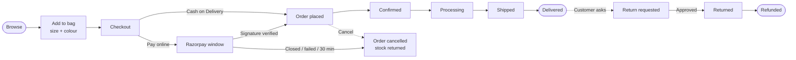
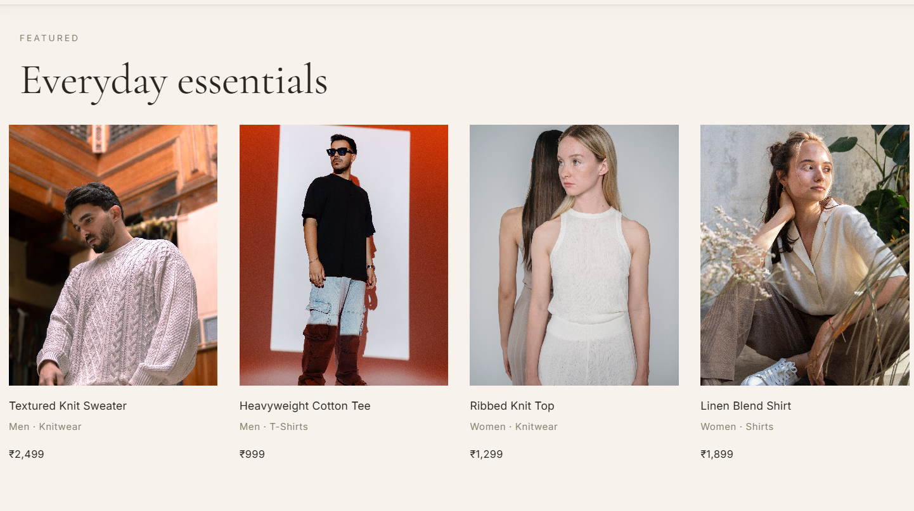
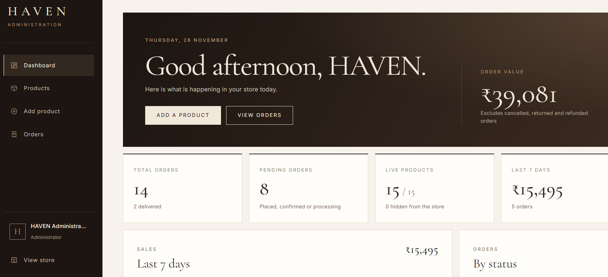

<div align="center">


<a href="https://haven-kappa-wheat.vercel.app">
  
</a>

<br/>

[](https://haven-kappa-wheat.vercel.app)
[](https://haven-kappa-wheat.vercel.app/admin/login)


</div>

<br/>

> **HAVEN** is a complete online clothing store: a scroll-driven landing experience, collection pages with video heroes, a real cart and checkout with **online payments**, customer accounts with **order tracking**, and an **admin panel** to manage products, stock and orders.
>
> 🧪 The payment flow runs in Razorpay **Test mode** on the demo: no real money moves.

<p align="center">
  <a href="#-features">Features</a> ·
  <a href="#-how-an-order-flows">Order flow</a> ·
  <a href="#-tech-stack">Stack</a> ·
  <a href="#-run-it-locally">Run locally</a> ·
  <a href="#-environment-variables">Env vars</a> ·
  <a href="#%EF%B8%8F-deployment">Deploy</a>
</p>

---

## ✨ Features

<table>
<tr>
<td width="50%" valign="top">

### 🛍️ Storefront
- Cinematic **scroll-driven intro** that opens into the home page
- **Video hero** sections for Women, Men, New Arrivals and Collection
- Filter by category and type, sort by newest or price, search
- Product pages with gallery, size/colour picker, **size guide**, reviews and related pieces
- Wishlist and a persistent cart
- Editorial design: ivory · espresso · caramel, *Cormorant Garamond* + *Inter*
- Responsive from phones to wide desktops

</td>
<td width="50%" valign="top">

### 💳 Orders & payments
- **Cash on Delivery** or **Razorpay** (UPI, cards, net banking, wallets, depending on your account)
- **Stock per size and colour**: sold-out options are greyed out, overselling is blocked
- Order history with a live **status timeline**
- Cancellations and returns with admin review
- **Automatic refunds** through Razorpay on cancellation or approved return
- Unpaid online orders expire after 30 minutes and release their stock

</td>
</tr>
<tr>
<td width="50%" valign="top">

### 📧 Emails customers receive
| When | Email |
|---|---|
| Sign up | Welcome |
| Order placed / paid | Order confirmation |
| Admin confirms / prepares | Confirmed · Processing |
| Dispatched | **Shipped** |
| Arrives | **Delivered** |
| Cancelled | Cancellation (+ refund note) |
| Return requested | Request received |
| Return decision | Approved · Rejected (with note) |
| Item received back | Return received |
| Money returned | Refunded |
| Forgot password | Reset link (30 min, single use) |

</td>
<td width="50%" valign="top">

### 🧑‍💼 Admin panel
- Insight **dashboard**: revenue, orders, recent activity
- Add / edit products with **drag-and-drop images** (Cloudinary), live previews and a **stock grid**
- Order management with status filters
- Role-protected routes (customer vs admin)
- Mobile-friendly tables that turn into cards on phones

### 🔒 Security
- Prices re-read from the database, never trusted from the browser
- Orders run in a **transaction**, stock decremented atomically
- Razorpay **signatures verified** server-side (+ optional webhook)
- bcrypt passwords, JWT auth, hashed one-time reset tokens
- Helmet headers, **rate limiting**, CORS locked to your site, NoSQL-operator sanitising, request-size limits

</td>
</tr>
</table>

## 🔄 How an order flows



Every step after *Order placed* updates the customer's tracking page and sends them an email.

## 🧱 Tech stack

| Layer | Technology |
|---|---|
| **Frontend** | React 19 · React Router 7 · Vite · hand-written CSS |
| **Backend** | Node.js · Express 5 |
| **Database** | MongoDB (Atlas) · Mongoose 9 |
| **Auth** | JSON Web Tokens · bcrypt |
| **Payments** | Razorpay |
| **Images** | Cloudinary (Multer uploads) |
| **Email** | Nodemailer (any SMTP provider) |
| **Hosting** | Vercel (client) · Render (server) · Atlas (database) |

<details>
<summary><b>📁 Project structure</b></summary>

```
HAVEN_PROJECT/
├── client/                 React app (Vite)
│   ├── public/media/       Hero videos and images
│   └── src/
│       ├── pages/          Home, Products, ProductDetails, Cart, Checkout, Orders, Profile…
│       ├── admin/          Dashboard, Products, Add product, Orders
│       ├── components/     Header, Footer, Intro, SizeGuide, StockGrid…
│       ├── context/        Auth, Cart and Wishlist state
│       ├── data/           sizeChart.js (edit to your real sizes)
│       ├── services/       api.js (all API calls)
│       └── styles/         One stylesheet per page or component
└── server/                 Express API
    ├── controllers/        Business logic
    ├── models/             User, Product, Order, Review, Wishlist
    ├── routes/             /api/auth, /products, /orders, /payments, /admin…
    ├── middleware/         auth, security (rate limits, sanitising)
    ├── utils/              email, razorpay, inventory, payment sweeper
    ├── scripts/            seed, createAdmin, migrateVariants
    └── tests/              Automated checks (npm test, no database needed)
```

</details>

## 🚀 Run it locally

**Requirements:** Node.js 20.19+, a MongoDB Atlas cluster (orders use transactions, so use Atlas rather than a bare local MongoDB). Cloudinary, Razorpay (test) and SMTP are optional while developing.

```bash
# 1. Install
cd server && npm install
cd ../client && npm install

# 2. Configure the server
cd ../server
cp .env.example .env              # then fill it in

# 3. Sample data + your admin account
npm run seed
npm run migrate:variants
node scripts/createAdmin.js       # needs ADMIN_EMAIL / ADMIN_PASSWORD (12+ chars) in .env

# 4. Start both apps (two terminals)
npm start                         # API     → http://localhost:5000
cd ../client && npm run dev       # website → http://localhost:5173
```

The admin panel lives at **`/admin/login`**.

## 🔐 Environment variables

<details>
<summary><b>Server</b> — <code>server/.env</code> (template in <code>server/.env.example</code>)</summary>

| Variable | Purpose |
|---|---|
| `MONGO_URI` | MongoDB Atlas connection string |
| `JWT_SECRET` | Random string, 32+ characters |
| `CLIENT_URL` | Your website address (CORS + email links) |
| `CLOUDINARY_CLOUD_NAME` · `CLOUDINARY_API_KEY` · `CLOUDINARY_API_SECRET` | Product image uploads |
| `RAZORPAY_KEY_ID` · `RAZORPAY_KEY_SECRET` | Online payments (`rzp_test_` keys while developing) |
| `RAZORPAY_WEBHOOK_SECRET` | Optional: confirms payments if a customer closes the tab |
| `SMTP_HOST` · `SMTP_PORT` · `SMTP_USER` · `SMTP_PASS` · `EMAIL_FROM` | Emails. If `SMTP_HOST` is empty, emails print in the terminal |
| `TRUST_PROXY` | `1` when running behind a hosting proxy |

</details>

<details>
<summary><b>Client</b> — <code>client/.env</code></summary>

| Variable | Purpose |
|---|---|
| `VITE_API_URL` | API address, e.g. `https://your-api.onrender.com/api` (defaults to `http://localhost:5000/api`) |

</details>

## ☁️ Deployment

The live demo runs on **MongoDB Atlas + Render + Vercel**, all free tiers. Full step-by-step instructions with every variable are in [`HOSTING_GUIDE.md`](./HOSTING_GUIDE.md).

> ⏳ Free Render servers sleep after inactivity, so the first request can take about a minute.

## 🧪 Tests

```bash
cd server && npm test        # security, payment-signature, stock and email checks
cd client && npm run lint
```


## 📸 Screenshots
Add your own screenshots to a docs/ folder, then delete this comment markers:

<p align="center">
   
   
</p>


## 🗺️ Roadmap

- [x] Online payments, refunds and transactional emails
- [x] Stock per size and colour
- [x] Order tracking and returns
- [ ] Shipping rates and GST invoices
- [ ] Discount codes
- [ ] Server-side rendering for better SEO

---

<div align="center">


<sub>Designed and built by <b>Manpreet kaur </b> · <a href="https://github.com/manpreetkaur80/">GitHub</a><br/>All product photos and videos are placeholders and belong to their respective owners.</sub>

</div>
